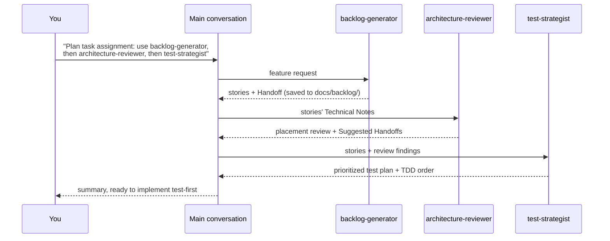

# Subagent Design Guide

## Purpose

This guide covers how to design effective Claude Code **subagents**: specialized assistants defined in `.claude/agents/*.md` that Claude can delegate work to. Each subagent runs in its own context window with its own system prompt, tool access, and model, and returns only its result to the main conversation.

Examples come from the three subagents shipped in this repository:

| Subagent | Role | Tools | Model |
|---|---|---|---|
| [`backlog-generator`](../../.claude/agents/backlog-generator.md) | Turns a feature request into INVEST user stories and saves them to `docs/backlog/` | `Read, Grep, Glob, Write` | `sonnet` |
| [`architecture-reviewer`](../../.claude/agents/architecture-reviewer.md) | Read-only Clean Architecture / DDD review for both stacks | `Read, Grep, Glob` | `inherit` |
| [`test-strategist`](../../.claude/agents/test-strategist.md) | Read-only test planning that drives TDD | `Read, Grep, Glob` | `sonnet` |

**Related:** [Customization Decision Guide](customization-decision-guide.md) (skill vs. subagent vs. hook…) · [Agent Governance Guide](agent-governance.md) · Lab 12 · [Official docs: Subagents](https://code.claude.com/docs/en/sub-agents)

---

## When to Create a Subagent

Create a subagent when at least one of these is true:

- **Context isolation helps.** The work reads many files or produces long output you don't need in your main conversation (reviews, codebase research, log analysis).
- **Tools should be restricted.** A reviewer that can't edit, a planner that can't run shell commands.
- **A different model or effort fits.** Fast and cheap for routine analysis, the strongest model for tricky design review.
- **It's a recurring role.** You keep typing the same "act as a … and check …" prompt.

Prefer a **skill** instead when you want to stay in the loop, the task needs your current conversation's context, or it's really a template or checklist. See [Skills vs. Subagents](customization-decision-guide.md#skills-vs-subagents).

Claude Code also ships built-in subagents — **Explore** (read-only codebase search), **Plan** (research during plan mode), and **general-purpose**. Don't recreate those; build subagents for *your* project's roles.

---

## Anatomy of a Subagent File

```markdown
---
name: architecture-reviewer            # required: lowercase, hyphens
description: Read-only Clean Architecture and DDD reviewer ... Use proactively after
  changes that add a reference or import between layers ...   # required: drives delegation
tools: Read, Grep, Glob                 # optional allowlist (omit = inherit all)
model: inherit                          # optional: sonnet | opus | haiku | inherit | full ID
color: blue                             # optional: UI color
---

# Architecture Reviewer

You are a senior software architect ...     ← system prompt (the body)

## Sources of Truth      ← context inputs
## Analysis Process      ← how to work
## Output Format         ← output contract
## Constraints           ← boundaries
```

Other useful frontmatter fields: `disallowedTools`, `permissionMode`, `maxTurns`, `skills` (preload skills), `mcpServers`, `hooks`, `memory`, `effort`, `background`, and `isolation: worktree`. See the [frontmatter reference](https://code.claude.com/docs/en/sub-agents).

Claude Code watches `.claude/agents/` and picks up added or edited files within a few seconds. Restart only if the `agents` directory didn't exist when the session started.

---

## The Eight Components of a Good Subagent

### 1. A clear role

Open the body with one or two sentences establishing who the agent is and what it does *not* do.

> *"You are an experienced product analyst and agile practitioner. You break requirements for the TaskManager API into small, valuable, testable user stories. You do not write production code or tests."* — `backlog-generator`

The "does not" clause matters as much as the role: it stops a planner from drifting into implementation.

### 2. A description written for delegation

The `description` is the **most important field**. Claude reads it (not the body) to decide whether to delegate, so it must say **what** the agent does and **when** to use it.

| Weak | Strong |
|---|---|
| `Reviews architecture.` | `Read-only Clean Architecture and DDD reviewer for the TaskManager .NET (src-dotnet/) and Spring Boot (src-springboot/) stacks. Use proactively after changes that add a reference or import between layers, introduce a new entity, value object, repository, or endpoint, or when a user story or design needs an architecture check before implementation.` |

Tips:
- Include trigger phrases like **"Use proactively when…"** or **"after…"** to encourage automatic delegation.
- Name concrete situations from your domain ("task assignment, priorities, due dates").
- State **inputs the caller must pass**. The architecture reviewer can't run git, so its description says: *"include the changed file paths (for example from `git diff --name-only`) in the task"*. The subagent only sees what the delegating prompt gives it plus what it reads itself.

### 3. Focused scope

One subagent, one job. If you find yourself writing "and also…", split it. The three shipped agents divide the feature workflow cleanly: **what** to build (backlog), **where** it belongs (architecture), **how** to prove it works (tests).

Narrow scope makes descriptions sharper, delegation more reliable, and outputs easier to chain.

### 4. Least-privilege tools

Give the agent only the tools its job requires. The `tools` field is an allowlist; `disallowedTools` removes tools from the inherited set.

| Agent | Tools | Why |
|---|---|---|
| `architecture-reviewer` | `Read, Grep, Glob` | Reviews must not change code. No `Bash`, so it can't run git — hence the "pass file paths" note in its description. |
| `test-strategist` | `Read, Grep, Glob` | Plans tests; the main conversation writes them (keeps TDD visible to the learner). |
| `backlog-generator` | `Read, Grep, Glob, Write` | Needs `Write` to save `docs/backlog/<slug>.md`, but nothing else. |

Omitting `tools` gives the subagent everything the main conversation has, including MCP tools. That's convenient but rarely what you want for a specialist. Remember that project permission rules in `.claude/settings.json` still apply to subagents.

### 5. The right model

| `model` value | Use when |
|---|---|
| `inherit` | Quality should match whatever the user chose (`architecture-reviewer` — design judgment). |
| `sonnet` | Strong, cost-effective default for structured analysis (`backlog-generator`, `test-strategist`). |
| `haiku` | Fast, cheap, high-volume lookups or summaries. |
| `opus` | The hardest reasoning tasks, when cost is acceptable. |

You can also set `effort` to raise or lower reasoning depth for that agent only.

### 6. Explicit context inputs ("Sources of Truth")

A subagent starts with a fresh context: it doesn't see your conversation. Tell it exactly where to look instead of hoping it finds the right files.

```markdown
## Sources of Truth
- `CLAUDE.md`, `src-dotnet/CLAUDE.md`, `src-springboot/CLAUDE.md`
- `.claude/rules/dotnet.md`, `.claude/rules/springboot.md`
- Existing tests under `src-dotnet/tests/` and `src-springboot/**/src/test/`
```

Project CLAUDE.md files are loaded for subagents, but listing the specific rule files and folders keeps reviews grounded in *this* repo instead of generic advice. A repo-specific **layer map** (as in `architecture-reviewer`) is even better.

### 7. An output contract

Define the exact output shape. Structured output is easier to read, compare across runs, and pass to the next agent.

```markdown
### Architecture Review Summary
- **Overall Assessment:** [Pass / Needs Attention / Refactor Required]
### Findings
#### ✅ Strengths   #### ⚠️ Concerns   #### 🚫 Violations
### Recommendations
### Suggested Handoffs
```

Good contracts:
- Use fixed headings and a small set of allowed values (Pass / Needs Attention / Refactor Required; P0–P3).
- Require **evidence** — file paths and line numbers — not generic advice.
- Say what the **final message** must contain. Only the final message returns to the main conversation, so `backlog-generator` says: *"Your final message must contain the full backlog so the main conversation can pass it on without re-reading the file."*

### 8. Handoffs and constraints

End with a **Handoff** section that names the next agent and what it should receive, and a **Constraints** section with hard boundaries.

```markdown
### Handoff
- **Saved to:** `docs/backlog/<feature-slug>.md`
- **Next:** architecture-reviewer should check the Technical Notes for layer placement;
  test-strategist can then plan tests from the acceptance criteria.

## Constraints
- Write stories from the user's point of view.
- Acceptance criteria must be specific and verifiable by a test.
- Call out assumptions instead of silently deciding them.
```

---

## Chaining and Handoffs

Subagents don't talk to each other directly. The **main conversation orchestrates**: it delegates to one subagent, receives the result, and passes the relevant parts to the next.



Ways to invoke:
- **Automatic:** describe the work; Claude matches it to a `description`.
- **By name in a prompt:** "Use the architecture-reviewer subagent to review `src-dotnet/src/TaskManager.Domain/...`".
- **@-mention:** `@agent-architecture-reviewer` guarantees that agent runs.
- **Whole session:** `claude --agent architecture-reviewer` runs the main thread with that agent's prompt, tools, and model.
- **Chain:** "Use backlog-generator, then architecture-reviewer, then test-strategist" — each step's Handoff tells Claude what to pass along.

Tips:
- Make each agent's output usable as the next agent's input (the stories' *Technical Notes* feed the reviewer; acceptance criteria feed the test strategist).
- Keep a **human checkpoint** between steps for anything that changes code.
- Subagents can spawn their own subagents (up to three levels by default) if you include `Agent` in `tools`, but flat orchestration from the main conversation is easier to follow and debug.

---

## Testing and Iterating

Treat a subagent like code: test it, review it, version it.

1. **Test delegation.** Describe a matching task *without* naming the agent. Does Claude pick it? If not, sharpen the `description` (add "use proactively", concrete triggers).
2. **Test for false triggers.** Ask for something adjacent ("refactor this method"). The reviewer shouldn't run.
3. **Test the output contract.** Run it on a known-good and a known-bad change (e.g. add `using Microsoft.EntityFrameworkCore;` to a Domain file). Does it report the violation with file and line, using the defined headings?
4. **Test the boundaries.** Ask the read-only reviewer to "fix it". It should explain it can't, not try.
5. **Iterate one change at a time** and compare outputs. Commit the agent file so improvements are shared and reviewable.
6. **Watch cost and context.** Use `/usage` and `/context`; if an agent is slow or expensive, narrow its scope, its tools, or switch `model`.

---

## Common Pitfalls

| Pitfall | Symptom | Fix |
|---|---|---|
| Vague `description` | Agent never runs, or runs for everything | State what + when, add trigger phrases and domain terms |
| Kitchen-sink scope | Long, unfocused output | Split into several focused agents |
| Inheriting all tools | A "reviewer" edits files | Set `tools` explicitly |
| Assuming shared context | Agent asks about things you already discussed | Pass inputs in the delegation prompt; list Sources of Truth |
| No output contract | Results vary run to run and are hard to chain | Fixed headings, allowed values, evidence requirements |
| Important result only in a file | Main conversation can't use it | Require the final message to contain the result |
| Generic advice | "Consider using SOLID principles" | Require file/line citations; add a repo-specific layer map |
| First agent in a brand-new `.claude/agents/` folder | Claude can't find the agent | Restart the session once the directory exists |

---

## Design Checklist

- [ ] Single, clearly stated role (including what it does **not** do)
- [ ] `description` says **what** and **when**, with trigger phrases and required inputs
- [ ] `tools` restricted to the minimum
- [ ] `model` chosen deliberately (`inherit`, `sonnet`, `haiku`, `opus`)
- [ ] Sources of Truth listed (CLAUDE.md, rules, key folders)
- [ ] Output format with fixed headings and evidence requirements
- [ ] Final message contains the full result
- [ ] Handoff section naming the next step
- [ ] Constraints section with hard boundaries
- [ ] Tested for delegation, false triggers, output shape, and boundaries
- [ ] Committed to `.claude/agents/` (or packaged in a plugin — Lab 15)

---

## Resources

- [Subagents](https://code.claude.com/docs/en/sub-agents)
- [Skills](https://code.claude.com/docs/en/skills)
- [Plugins](https://code.claude.com/docs/en/plugins) — share subagents across repos
- [Customization Decision Guide](customization-decision-guide.md)
- [Agent Governance Guide](agent-governance.md)
