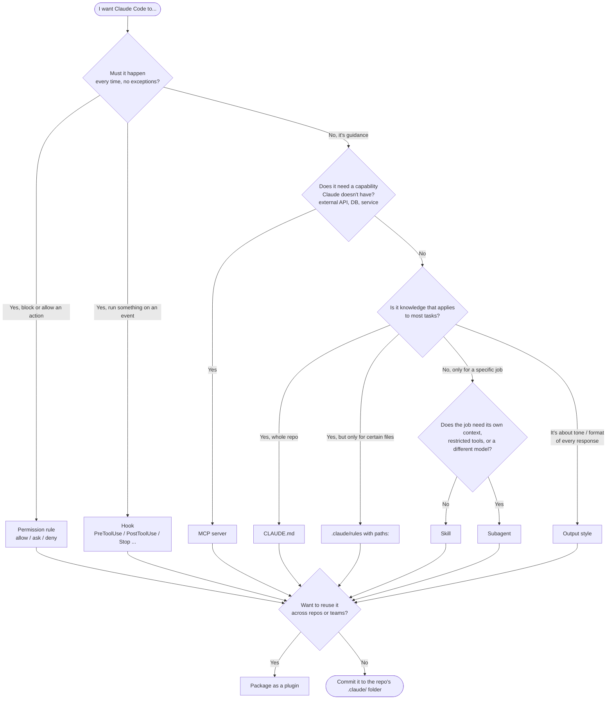
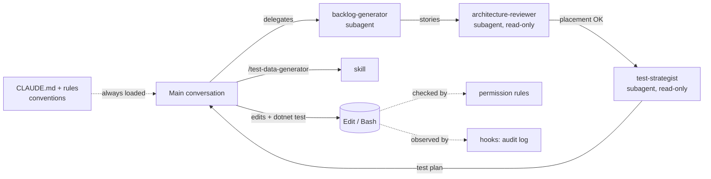

# Claude Code Customization Decision Guide

## Purpose

Claude Code has many ways to customize its behavior. This guide helps you pick the right one for a given need, using the assets shipped in this repository as examples.

**Who this is for:** workshop participants, tech leads, and anyone setting up Claude Code for a team.

**Related:** [Agent Design Guide](agent-design-guide.md) · [Agent Governance Guide](agent-governance.md) · [Official docs: Extend Claude Code](https://code.claude.com/docs/en/features-overview)

---

## The Customization Types at a Glance

| Mechanism | Where it lives | Loaded / triggered | Best for | Workshop lab |
|---|---|---|---|---|
| **CLAUDE.md** (memory) | `./CLAUDE.md`, `src-dotnet/CLAUDE.md`, `~/.claude/CLAUDE.md`, `CLAUDE.local.md` | Always, at session start (subdirectory files load when Claude works there) | Project facts and conventions that apply to nearly every task | Lab 2 |
| **Rules** | `.claude/rules/*.md` (optional `paths:` frontmatter) | Without `paths:` — always. With `paths:` — only when Claude touches matching files | Conventions that apply to one stack, folder, or file type | Lab 2 |
| **Skills** (incl. former custom commands) | `.claude/skills/<name>/SKILL.md` (legacy `.claude/commands/*.md` still work) | On demand — you type `/name`, or Claude invokes it when the `description` matches | Repeatable procedures, checklists, templates, "how we do X" | Labs 8, 11 |
| **Subagents** | `.claude/agents/<name>.md` | Delegated by Claude based on `description`, or explicitly (`@agent-name`, "use the X subagent") | Specialized roles that need their own context window, tools, or model | Lab 12 |
| **Hooks** | `hooks` in `.claude/settings.json` | Deterministically, on lifecycle events (`PreToolUse`, `PostToolUse`, `Stop`, `SessionStart`, …) | Things that must *always* happen — guards, formatting, audit logs, notifications | Lab 9 |
| **Permissions & settings** | `.claude/settings.json`, `.claude/settings.local.json`, `~/.claude/settings.json`, managed settings | Every tool call is checked against allow / ask / deny rules and the current permission mode | Safety boundaries, pre-approving safe commands, team defaults | Labs 1, 4, 9 |
| **MCP servers** | `.mcp.json` (project), `~/.claude.json` (local/user) — via `claude mcp add` | Tools available every session; Claude calls them when useful | New capabilities: external systems, APIs, databases (GitHub, Jira, browsers) | Lab 10 |
| **Output styles** | `.claude/output-styles/*.md`, `~/.claude/output-styles/` | Replaces part of the system prompt for the whole session (`/output-style`) | *How* Claude communicates — teaching mode, concise mode, personas | Lab 14 |
| **Plugins** | A directory with `.claude-plugin/plugin.json` plus `skills/`, `agents/`, `hooks/`, `.mcp.json` | Installed via `/plugin` from a marketplace (or `--plugin-dir` for testing) | Packaging and distributing any of the above across repos and teams | Lab 15 |

> **The one-line version:** CLAUDE.md and rules are *what Claude knows*. Skills are *procedures it can follow*. Subagents are *specialists it can delegate to*. MCP adds *tools it can use*. Hooks and permissions are *guarantees you enforce*. Output styles change *how it talks*. Plugins *ship* all of it.

---

## Decision Flow

### Five questions to ask

1. **Is this a guarantee or a suggestion?** Anything in CLAUDE.md, rules, skills, or subagents is guidance the model *should* follow. If skipping it would be a real problem (formatting before commit, blocking `rm -rf`, never reading `.env`), use a **hook** or a **permission rule** — they run outside the model.
2. **Does Claude need a new capability?** If it has to talk to a system it can't reach with its built-in tools (an issue tracker, a cloud API, a browser), that's **MCP**. If it just needs to know *how* to use something it already can reach, that's a skill or CLAUDE.md.
3. **How often does it apply?** Nearly always → **CLAUDE.md**. Only for some files → **rule with `paths:`**. Only for a particular task → **skill** or **subagent**. Loading things "just in case" wastes context on every turn.
4. **Does it need isolation?** If the work would flood the main conversation with file reads, should run with fewer tools (read-only review), or benefits from a different model, make it a **subagent**. Otherwise a **skill** is simpler and keeps you in the loop.
5. **Who else needs it?** Commit project-level files to `.claude/` for this repo; use `~/.claude/` for personal preferences; package a **plugin** when several repos or teams need the same thing.

---

## Detailed Comparison

| | CLAUDE.md | Rules | Skill | Subagent | Hook | MCP |
|---|---|---|---|---|---|---|
| **Context cost** | Every session | Always (no `paths:`) or on matching files | Only the `description` until used | Runs in its own context window; only the result returns | None (runs outside the model) | Tool definitions (deferred until needed) |
| **Deterministic?** | No | No | No | No | **Yes** | Tools are; when to call them isn't |
| **Who triggers it** | Automatic | Automatic | You (`/name`) or Claude | Claude (by description) or you (`@agent-…`) | Lifecycle event | Claude |
| **Can restrict tools** | No | No | `allowed-tools` pre-approves tools | `tools` / `disallowedTools` allowlist | Can block a tool call (exit 2) | Adds tools |
| **Can choose model / effort** | No | No | `model`, `effort` | `model`, `effort` | n/a | n/a |
| **Typical size** | < 200 lines | Short, focused | One `SKILL.md` + optional templates/scripts | One `.md` with a system prompt | A command or script | A server process or URL |

---

## Scenarios from This Repository

### "Every .NET file should use file-scoped namespaces and sealed classes"
**Use: a rule with `paths:`** — see [`.claude/rules/dotnet.md`](../../.claude/rules/dotnet.md), scoped to `src-dotnet/src/**/*.cs` and `src-dotnet/tests/**/*.cs`. Spring Boot developers never pay the context cost for C# conventions, and vice versa with [`springboot.md`](../../.claude/rules/springboot.md).

*Why not CLAUDE.md?* It would load C# rules for Java work. *Why not a skill?* Conventions should apply automatically, not when someone remembers to invoke them.

### "Ask clarifying questions before big changes"
**Use: an always-on rule** — [`.claude/rules/follow-up-questions.md`](../../.claude/rules/follow-up-questions.md) has no `paths:`, so it loads every session like CLAUDE.md, but stays in its own file so teams can adopt or drop it independently.

### "Generate realistic test data that respects domain invariants"
**Use: a skill** — [`/test-data-generator`](../../.claude/skills/test-data-generator/SKILL.md). It's a procedure with templates, needed only while writing tests, and works fine in the main conversation. `allowed-tools: Read Grep Glob` keeps it read-only; `argument-hint` documents `/test-data-generator Task 5 csharp`.

### "Review my change for Clean Architecture violations"
**Use: a subagent** — [`architecture-reviewer`](../../.claude/agents/architecture-reviewer.md). The review reads many files (which would clutter your main context), should be **read-only** (`tools: Read, Grep, Glob`), and returns a structured report. Its `description` says "use proactively after changes that add a reference or import between layers", so Claude delegates to it automatically.

### "Turn a feature request into user stories, then check the design, then plan the tests"
**Use: chained subagents** — [`backlog-generator`](../../.claude/agents/backlog-generator.md) → [`architecture-reviewer`](../../.claude/agents/architecture-reviewer.md) → [`test-strategist`](../../.claude/agents/test-strategist.md). Each has its own role, tools, and output contract, and each ends with a "Handoff" section the next one consumes. See Lab 12 and the [Agent Design Guide](agent-design-guide.md#chaining-and-handoffs).

### "Never run `git push --force` or read `.env`"
**Use: permission `deny` rules** in [`.claude/settings.json`](../../.claude/settings.json). They apply in every permission mode and to subagents too. Instructions in CLAUDE.md alone can be ignored or forgotten; a deny rule can't.

### "Log every shell command Claude runs"
**Use: a `PreToolUse` hook** — the shipped settings append each `Bash` call to `.claude/audit.log`. Hooks receive the event as JSON on stdin (the repo uses `jq` to parse it). Exit code `2` blocks the action; other non-zero codes are reported but don't block.

### "Let Claude read and comment on GitHub issues in my fork"
**Use: an MCP server** — the GitHub MCP server (Lab 10). Claude can't reach the GitHub API with its built-in tools; MCP adds that capability. Add it with `claude mcp add --transport http …` and choose a scope: `local` (just you, this repo), `project` (written to `.mcp.json` and shared), or `user` (you, every repo).

### "Explain what you're doing as you go — this is a teaching workshop"
**Use: an output style** — the built-in `Explanatory` or `Learning` styles, or a custom one in `.claude/output-styles/` (Lab 14). Output styles change the system prompt for the whole session; add `keep-coding-instructions: true` to a custom style if it should keep Claude's default software-engineering instructions.

### "Share our reviewer agent and test-data skill with five other repos"
**Use: a plugin** (Lab 15). Put the agent and skill in a plugin directory with `.claude-plugin/plugin.json`, test it with `claude --plugin-dir ./my-plugin`, then publish it in a marketplace your team adds with `/plugin`.

---

## Skills vs. Subagents

This is the most common point of confusion, because both can be "a markdown file with instructions".

| Choose a **skill** when… | Choose a **subagent** when… |
|---|---|
| You want to stay in the loop and iterate | The work is self-contained and returns a summary |
| The procedure needs the current conversation's context | The work would flood your context (many files, long logs) |
| Normal tool access is fine | You want to **restrict** tools (e.g. read-only reviewer) |
| You'll invoke it explicitly with `/name` | Claude should delegate to it automatically as a specialist |
| It's a template, checklist, or reference | It's a **role** with its own system prompt and output contract |

They also compose:
- A subagent can preload skills with the `skills:` frontmatter field.
- A skill can run in a forked subagent context with `context: fork` (optionally choosing an `agent:` type).
- The shipped `test-strategist` subagent points to the `/test-data-generator` skill for test data needs.

> **Custom commands are now skills.** A file at `.claude/commands/deploy.md` and a skill at `.claude/skills/deploy/SKILL.md` both create `/deploy`. Prefer skills for new work — they support supporting files, frontmatter like `allowed-tools`, and automatic invocation.

---

## CLAUDE.md vs. Rules vs. Skills (Context Budget)

Everything always-loaded competes with your actual task for context. Use `/context` to see what's loaded.

- Keep **CLAUDE.md** short: build commands, architecture map, non-obvious conventions, and "don't do X". Move anything long or situational out.
- Move **stack- or folder-specific** guidance into **rules with `paths:`**.
- Move **procedures** ("how to add an endpoint", "how to write an ADR") into **skills** — only their one-line description is loaded until used.
- Use `@path/to/file` imports in CLAUDE.md to pull in an existing doc instead of duplicating it — but remember imported files are loaded too.

---

## Combining Mechanisms

Real workflows usually combine several mechanisms. The Lab 3 → Lab 12 feature flow in this repo looks like this:

Common pairings:
- **Rule + hook:** the rule says "format before committing"; a `PostToolUse` hook actually runs the formatter.
- **Subagent + skill:** the subagent owns the role, the skill holds the reusable template.
- **MCP + skill:** MCP provides the Jira/GitHub tools; a skill describes your team's workflow for using them.
- **Permissions + permission modes:** rules define *what* is allowed; the mode (Manual, Accept edits, Plan, Auto — Shift+Tab) defines *how much* Claude asks along the way.

---

## Team Governance Tips

- **Commit** `CLAUDE.md`, `.claude/rules/`, `.claude/skills/`, `.claude/agents/`, `.claude/settings.json`, and `.mcp.json`. Review changes to them like code.
- **Don't commit** `CLAUDE.local.md` or `.claude/settings.local.json` — they're for personal overrides.
- Put organization-wide security policy in **managed settings**, which users and projects can't override.
- Give every skill and subagent a specific `description`; vague descriptions cause missed or false triggers.
- Start small: one CLAUDE.md, a few deny rules, one skill. Add subagents and plugins when a real need appears.
- See the [Agent Governance Guide](agent-governance.md) for review processes and enterprise rollout.

---

## Quick Reference Cheat Sheet

| I want to… | Use | File |
|---|---|---|
| Tell Claude how to build and test | CLAUDE.md | `CLAUDE.md` |
| Apply conventions only to Java files | Rule | `.claude/rules/springboot.md` with `paths:` |
| Keep my personal preferences out of git | User memory / local memory | `~/.claude/CLAUDE.md`, `CLAUDE.local.md` |
| Run a repeatable procedure with `/name` | Skill | `.claude/skills/<name>/SKILL.md` |
| Delegate a review to a read-only specialist | Subagent | `.claude/agents/<name>.md` |
| Block a dangerous command | Permission deny rule | `.claude/settings.json` |
| Pre-approve safe commands | Permission allow rule | `.claude/settings.json` |
| Run a script after every edit | `PostToolUse` hook | `.claude/settings.json` |
| Connect to GitHub / Jira / a database | MCP server | `.mcp.json` via `claude mcp add --scope project` |
| Change Claude's tone for a session | Output style | `/output-style`, `.claude/output-styles/` |
| Plan before editing | Plan permission mode | Shift+Tab or `/plan` |
| Share all of the above across repos | Plugin | `.claude-plugin/plugin.json` |

---

## Resources

- [Extend Claude Code (features overview)](https://code.claude.com/docs/en/features-overview)
- [Memory (CLAUDE.md and rules)](https://code.claude.com/docs/en/memory)
- [Skills](https://code.claude.com/docs/en/skills)
- [Subagents](https://code.claude.com/docs/en/sub-agents)
- [Hooks](https://code.claude.com/docs/en/hooks)
- [Settings](https://code.claude.com/docs/en/settings) and [Permissions](https://code.claude.com/docs/en/permissions)
- [MCP](https://code.claude.com/docs/en/mcp)
- [Output styles](https://code.claude.com/docs/en/output-styles)
- [Plugins](https://code.claude.com/docs/en/plugins)
