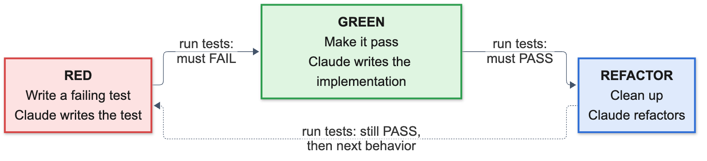

# Module 03: TDD with Claude Code

## Make Claude Code follow the loop, and make it stick

---

# Left Alone, Claude Writes Tests and Code Together

Your team has already chosen TDD. The question is whether Claude Code will follow it.

```
You: Write tests and implementation for NotificationService
Claude Code: [writes both at once]
             [runs tests — they all pass]
             [done!]
```

**Problem:** you never saw a test fail, so you don't know the tests test anything.
Tests written alongside the implementation are shaped by it, not by the spec.

**This module: make the loop the default, then make it stick.**

---

# The Red-Green-Refactor Loop



**Claude Code runs the tests at every step.** You review the output.

---

# What "Directing a Workflow" Means

<style scoped>
section { font-size: 24px; }
</style>

**Wrong approach** (no checkpoints):
```
You: Write NotificationService with tests
Claude Code: [writes both at once, you accept or reject]
```

**Right approach** (one checkpoint per phase):
```
You: Write the tests for NotificationService. Don't write the implementation.
Claude Code: [writes the tests, runs them, they fail]

You: Now implement it so they pass.
Claude Code: [writes the code, runs the tests, they pass]

You: Refactor, and keep the tests green.
Claude Code: [refactors, re-runs the tests]
```

**You choose the granularity:** the whole class for well-understood behavior, one case at a time when exploring.

---

# Four Ways to Make It Stick

<style scoped>
section { font-size: 24px; }
</style>

| Level | How | Guarantee |
|---|---|---|
| **Prompt** | You ask for the failing test first, every time | None: depends on you |
| **`CLAUDE.md` / rule** | "Failing test first" as a standing instruction (Lab 3) | Soft: context, not enforcement |
| **Skill** | A `/tdd` command that scripts the loop (Lab 11) | Soft: still just instructions |
| **Hooks** | Run tests after every edit, deny production edits until a test has changed, block "done" while tests fail (Lab 9) | **Hard**: deterministic, can't be talked out of |

Hooks can verify that tests were touched and run. They can't tell *red* from *refactoring on green*, so the first three levels still carry the order of the loop.

---

# Reviewing Multi-File Diffs (.NET)

Claude Code often changes multiple files in one step.

```
Files modified:
  src-dotnet/src/TaskManager.Application/Services/NotificationService.cs  (+45 lines)
  src-dotnet/src/TaskManager.Application/Notifications/INotificationService.cs (+8 lines)
  src-dotnet/tests/TaskManager.UnitTests/Services/NotificationServiceTests.cs (+62 lines)
```

**Before accepting:**
1. Read the test file — does it test what you asked?
2. Read the implementation — does it match your conventions?
3. Run `git status`, then stage and `git diff --staged`: new files don't show in plain `git diff`

**Never accept a multi-file change without reviewing all files.**

---

# Reviewing Multi-File Diffs (Spring Boot)

Claude Code often changes multiple files in one step.

```
Files modified:
  src-springboot/taskmanager-application/.../DefaultNotificationService.java  (+45 lines)
  src-springboot/taskmanager-application/.../NotificationService.java  (+8 lines)
  src-springboot/taskmanager-application/.../DefaultNotificationServiceTest.java  (+62 lines)
```

**Before accepting:**
1. Read the test file — does it test what you asked?
2. Read the implementation — does it match your conventions?
3. Run `git status`, then stage and `git diff --staged`: new files don't show in plain `git diff`

**Never accept a multi-file change without reviewing all files.**

---

# Tests as a Feedback Loop (.NET)

<style scoped>
section { font-size: 24px; }
</style>

Claude Code fixes its own test failures:

```
You: Run the tests

Claude Code:
  Bash(dotnet test) → 2 failures
  
  Failed: NotificationService_SendAsync_WhenTaskNotFound_ThrowsException
  Expected: ArgumentException
  Actual: NullReferenceException
  
  [reads the implementation]
  [fixes the null guard]
  
  Bash(dotnet test) → all passing
  
  Fixed: added null check before repository call.
```

**This loop can run 3–4 times before you see the final result.**
You review the final state — not every intermediate step.

---

# Tests as a Feedback Loop (Spring Boot)

<style scoped>
section { font-size: 24px; }
</style>

Claude Code fixes its own test failures:

```
You: Run the tests

Claude Code:
  Bash(mvn clean test) → 2 failures
  
  Failed: DefaultNotificationServiceTest > shouldThrowExceptionWhenSendingEmailForNullTask
  Expected: IllegalArgumentException
  Actual: NullPointerException
  
  [reads the implementation]
  [fixes the null guard]
  
  Bash(mvn clean test) → all passing
  
  Fixed: added null check before calling the sender.
```

**This loop can run 3–4 times before you see the final result.**
You review the final state — not every intermediate step.

---

# Naming Tests for Clarity (.NET)

Claude Code follows your naming convention from CLAUDE.md.
Make sure it's there:

```markdown
## Testing Conventions

Test method naming: `MethodName_StateUnderTest_ExpectedBehavior`
Examples:
  SendAsync_WhenTaskNotFound_ThrowsArgumentException
  SendAsync_WhenAlreadyComplete_ReturnsFailureResult
  SendAsync_WhenValid_PublishesNotificationEvent
```

Good test names are documentation.
Bad test names are `Test1`, `ShouldWork`, `TestSendAsync`.

---

# Naming Tests for Clarity (Spring Boot)

Claude Code follows your naming convention from CLAUDE.md.
Make sure it's there:

```markdown
## Testing Conventions

Test method naming: `shouldDoX` plus a readable `@DisplayName`
Group related tests in `@Nested` classes
Examples:
  shouldCreateTaskWithTitleOnly
  shouldThrowExceptionWhenCreatingTaskWithNullTitle
  shouldSaveTaskToRepositoryWhenCreating
```

Good test names are documentation.
Bad test names are `test1`, `testCreate`, `shouldWork`.

---

# What Claude Code Tests Well

| Claude Code excels at | Be more hands-on with |
|---|---|
| Happy path tests | Edge cases you haven't described |
| Error handling for named exceptions | Concurrency bugs |
| Boundary conditions (nulls, empty) | Performance tests |
| CRUD handler coverage | Tests that need real data fixtures |
| Following your naming convention | Integration tests with side effects |

**The pattern:** Claude Code is great at covering the cases you name.
You need to think about the cases worth naming.

---

# Integration Tests vs. Unit Tests (.NET)

<style scoped>
section { font-size: 27px; }
</style>

**Unit tests** (most of Lab 3):
```csharp
// FakeItEasy for mocks — fast, isolated
var repo = A.Fake<ITaskRepository>();
A.CallTo(() => repo.FindByIdAsync(taskId, A<CancellationToken>._))
    .Returns((DomainTask?)null);
```

**Integration tests** (.NET stubs in `src-dotnet/tests/TaskManager.IntegrationTests/`; Spring uses MockMvc):
```csharp
// Full HTTP stack — slower, catches wiring bugs
var response = await client.PostAsJsonAsync("/tasks", request);
```

Lab 3 focuses on unit tests (+ MockMvc on Spring).
The .NET `POST/GET/PUT /tasks` integration stubs are **Lab 5** — characterization tests before refactoring.

---

# Integration Tests vs. Unit Tests (Spring Boot)

<style scoped>
section { font-size: 25px; }
</style>

**Unit tests** (most of Lab 3):
```java
// Mockito for mocks — fast, isolated
@Mock private TaskRepository taskRepository;
when(taskRepository.findById(taskId)).thenReturn(Optional.empty());
```

**Integration tests** (`@SpringBootTest` + MockMvc, e.g. `TaskApiIntegrationTest`):
```java
// Full HTTP stack — slower, catches wiring bugs
mockMvc.perform(post("/api/tasks")
        .contentType(MediaType.APPLICATION_JSON)
        .content(requestJson))
    .andExpect(status().isCreated());
```

Lab 3 focuses on unit tests (+ MockMvc for the endpoint in Part 2).
Spring ships real integration tests already; **Lab 5** adds characterization tests before refactoring.

---

# From Requirements to Code

Part 1 hands you an interface. Real work starts with a **user story**.

```
As a user, I want to manage tasks with priorities and due dates
so that I can focus on what's important and meet deadlines.
```

1. **`/plan`** — decompose into backlog items (no edits until you approve)
2. **Domain** — `Priority` value object, `DueDate` on `Task` — tests first
3. **Application** — `CreateTaskCommand` → `TaskService` — tests first
4. **API** — `POST /tasks` (curl on .NET, MockMvc on Spring)
5. **ADR** — record *why* in `docs/adr/0001-task-priority-model.md`

---

# Plan Mode for Decomposition

```
/plan Break this user story into 4–6 backlog items that each fit
in a small PR. Acceptance criteria, layers touched, dependencies.
The only file to write is docs/backlog/task-priorities.md.
```

- Claude reads the domain and API code — **edits are blocked**
- You review one plan, push back ("split Item 3"), then approve
- The backlog file becomes context for later sessions

Lab 4 covers plan mode in depth — here it's just a tool.

---

# Architecture Decision Records

Tests capture *what*. Code captures *how*. **ADRs capture why.**

```markdown
# ADR 0001: Model task priority as a value object
Status: Accepted
Context:    Priority needs validation, ordering, and a clear error...
Decision:   Sealed record with FromName(); string at the API boundary
Consequences: + Invalid states unrepresentable  − Mapping at the edges
Alternatives: plain enum, raw string
```

Then one line in `CLAUDE.md`: *"Read relevant ADRs in docs/adr/ before changing domain models."*

---

# Lab 3 Preview

<style scoped>
section { font-size: 22px; }
</style>

## Part 1 — Implement `NotificationService` using TDD:

1. Ask Claude Code to write a failing test for the first case
2. Confirm it fails (`dotnet test` or `mvn test`)
3. Ask for the minimal implementation to make it pass
4. Confirm it passes
5. Repeat for each behavior, then add a TDD rule and watch it stick

## Part 2 — Requirements → Code

User story → backlog (plan mode) → `Priority` + `DueDate` → create-task endpoint → ADR

## The Key Discipline

Before accepting each step: **read the test Claude Code wrote.**
Does it test what you intended? Is the assertion meaningful?

---

# Lab 3: TDD with Claude Code

👉 Open [docs/labs/lab-03-tdd-with-claude-code.md](../../../labs/lab-03-tdd-with-claude-code.md)

**Goal for the next 90–100 minutes** (Part 1 ≈ 45–50, Part 2 ≈ 45):
- `NotificationService` implemented test-first
- All tests named with the workshop convention
- You ran the tests yourself at least once and saw the red → green transition
- A user story taken to a working endpoint, plus an ADR

Short on time? Finish Part 1; Part 2 makes a good homework exercise.

**Bilingual note:** Labs 3 and 5 have separate .NET and Spring Boot walkthroughs. Use the section for your stack.

---

<!-- Navigation -->
[← 02 CLAUDE.md](02-claude-md-memory.md) | **Day 1 Module 03** | [Next: Plan Mode, Permission Modes & Thinking →](04-plan-mode-extended-thinking.md)
